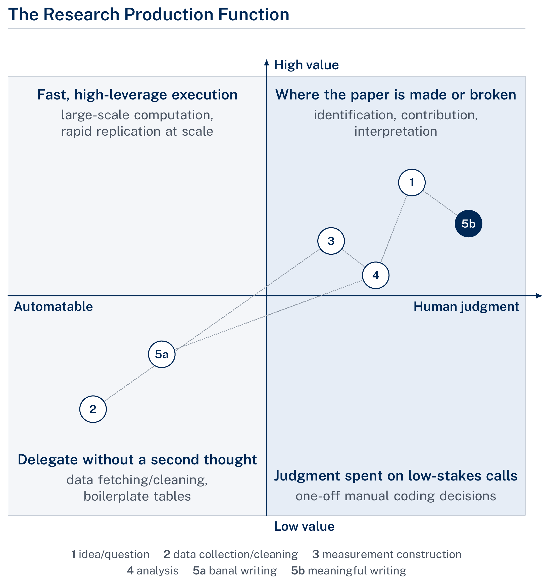
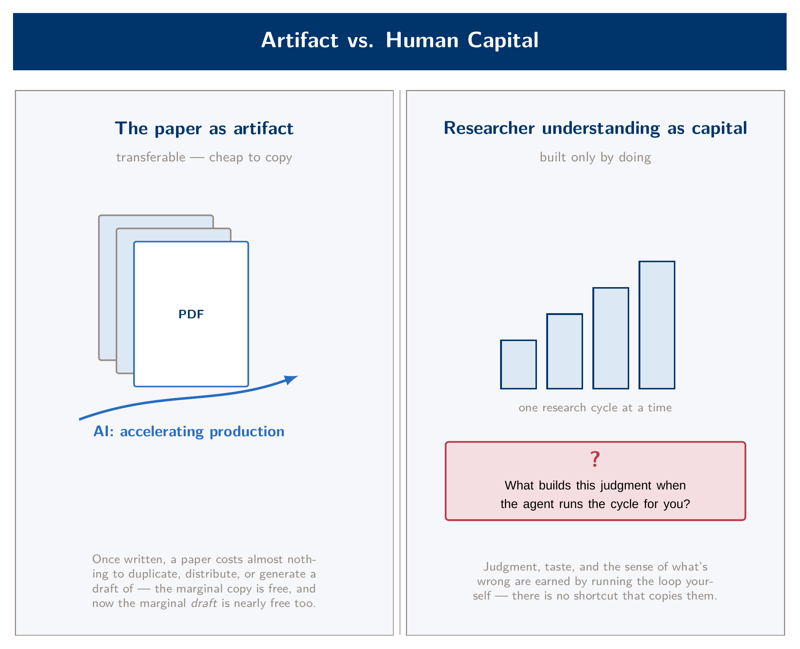
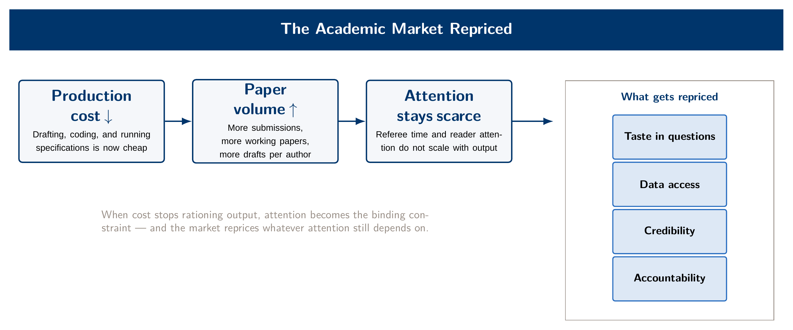

```{=html}
<div class="module-banner"></div>
```

::: {.module-links}
[[]{.bi .bi-play-btn aria-hidden="true"} Video (9 min)](#module-video){.is-primary}
[[]{.bi .bi-file-earmark-pdf aria-hidden="true"} Module 6 slides (PDF)](../assets/slides/day6_slides.pdf)
:::

```{=html}
<div class="module-video" id="module-video">
  <p class="module-video__label" id="module-video-label">
    <span class="bi bi-play-circle" aria-hidden="true"></span>
    Watch: Module 6 walkthrough (9 min, narrated slides)
  </p>
  <div class="module-video__frame">
    <video controls preload="metadata" playsinline
           poster="../assets/video/module6_poster.jpg"
           aria-labelledby="module-video-label">
      <source src="../assets/video/module6_seminar.mp4" type="video/mp4">
      <track kind="captions" src="../assets/video/module6_seminar.en.vtt"
             srclang="en" label="English" default>
      <p>Your browser cannot play this video.
        <a href="../assets/video/module6_seminar.mp4">Download the MP4</a> instead.</p>
    </video>
  </div>
  <p class="module-video__meta">
    <a href="../assets/video/module6_seminar.mp4" download>
      <span class="bi bi-download" aria-hidden="true"></span> Download video (MP4, 21 MB)</a>
    <span aria-hidden="true">·</span>
    <a href="../assets/video/module6_seminar.en.vtt" download>Captions (WebVTT)</a>
  </p>
</div>
```

For five modules you have been building. You pulled a firm-year panel from public filings in an eighty-minute lab, turned a folder of 10-Ks into a defensible text measure, connected an agent to WRDS on your own credentials, and hardened one of those pipelines into a repo a stranger could rerun from the README. In 2019, each of those tasks would have taken a competent RA days to weeks. This seminar is about that change. There is no lab in this module. You already know how to do these things. The question now is what it means for the profession that anyone can.

The seminar is organized around three questions, from least to most uncomfortable. First, if AI produces the artifact, what happens to the learning? What is PhD training for? Second, does it matter, epistemically or socially, whether a human or a machine produced a result? Third, papers are the currency of the academic labor market. What happens to that market when the cost of producing a competent paper collapses? None of these questions has a settled answer. You will be asked to defend a position, not to find the right one. The deliverable is a one-page memo titled "What I will still be paid for in 2036," and it asks you to commit to your own answer.

::: {.callout-note icon=false}
## What this module asks of you

Do the readings before you start. They are short on purpose, and every discussion block draws on them. Keep your own dissertation in mind: the sorting exercises are about your research, not research in general. Be willing to be argued out of a position. When the seminar runs with a group, debate positions are assigned in advance and are adversarial by design, so some people defend claims they do not believe. Arguing a side you disagree with is part of the exercise.
:::

::: {.callout-note icon=false}
## If you're working alone or in a small group

There are no assigned positions and no room, so turn each block into writing. Do the placement exercise on the blank map and write two sentences on the placement your advisor would most likely dispute. For each question, write a half-page for the side you find weaker, then a half-page reply, using one reading on each side, and end with your answer to the block's closing question. In a group of two or three, split the sides before you read and swap halfway. Allow about 30 minutes per question. There is no due date for the memo; write it within a week of finishing the readings, while the arguments are fresh.
:::

## The map you already know

In Module 1 you saw the research pipeline (idea, data, measure, analysis, paper), shaded by where an agent speeds up the work and where judgment stays human. You have now worked through that map across the course, so this module uses a harder version of it. The same pipeline is plotted on two axes: how automatable each stage is, and how much of the paper's value it carries.

{fig-alt="Map of research pipeline stages plotted on two axes: how automatable each stage is and how much of a paper's value it carries."}

Most of this course worked in the upper-left quadrant: execution work that an agent does faster than you and about as well. The upper-right quadrant is where papers succeed or fail: identification, contribution, interpretation. The rest of this module builds on one uncomfortable observation. The boundary between those quadrants moves. Measurement construction, which you worked on in Module 3, has been moving toward the automatable side. At the start of the seminar, you place your own dissertation's stages on a blank version of this map, on your own and without discussion. In a group run, Block 1 then opens with two volunteers defending their placements.

## Question 1 — The artifact and the capital

A paper is an artifact: transferable, citable, and cheap to copy once it exists. A researcher's understanding is capital. It is built only by doing the work, and it is what a PhD program exists to produce. For most of the profession's history the two came bundled. You could not produce the artifact without building the capital, so the paper was reliable evidence about the researcher. Agentic AI unbundles them. Across this course you produced artifacts faster than your own understanding alone could have supported. The question is what happened to your capital during those same hours.

{fig-alt="Diagram contrasting the paper as a transferable artifact with the researcher's understanding as capital, and agentic AI splitting the bundle between them."}

The evidence assigned for this module is mixed, and the bad news is easier to remember. Bastani and coauthors ran a field experiment with nearly 1,000 high-school math students. Access to GPT-4 raised practice grades by 48 percent. Once access was taken away, the students who had used it scored 17 percent worse than students who never had it. A version of the tool built as a tutor, with safeguards, largely removed that harm. The second paper is about experts. Budzyń and coauthors studied endoscopists at four Polish centres. After the clinics started using AI to help spot adenomas, the doctors' detection rate on colonoscopies done *without* the AI fell from 28.4 to 22.4 percent. These were experienced professionals, and nobody set out to change how they worked. The authors read the drop as possible deskilling. The design compares three months before with three months after, with no control group, which is worth arguing about in its own right. Bastani suggests that how the tool is set up matters. So does graduate training, or the way you configure your own tools, protect the skill, or only delay the decline? That question is open.

Module 5 gave you the personal version of this question: the banal/meaningful line and its test, which asks whether you can discuss the finding without the LLM. This module asks the institutional version. If researchers no longer have to build the capital to produce the artifact, does the profession keep building it on purpose, the way we still teach proofs to students who will never prove anything new? Or does PhD training gradually turn into something else?

## Question 2 — Provenance: man versus machine

Take two identical extraction results from the Module 3 pipeline. An RA hand-coded one over three weeks. The other came from a Claude session with a complete audit trail: cached inputs, a quality report, committed code, and a stratified human audit sample. Are they epistemically equivalent? Should a referee treat them identically? Most people's intuitions say both no and yes, and this block works through that conflict.

The institutional reference point is a rule several journals now share. *Nature* set it out in 2023, and the AER and the American Accounting Association's journals (policy PUB-009) have since adopted versions of it. It has two parts. No language model can be an author, because authorship carries accountability that a model cannot take on. And any use of these tools must be disclosed: the AAA asks for a declaration section before the references, and the AEA asks referees as well as authors to disclose. The first part echoes a line attributed to a 1979 IBM internal training slide (the original has never been located), written four decades before the technology: a computer can never be held accountable. The second part is where the profession is now putting its practical effort: disclosure policies, audit trails, and verification as the basis of credibility. You built that discipline in Module 5. The paper trail catches mistakes, and it also makes your work readable to a profession that is starting to care about provenance.

Two complications make this less tidy. First, a spotless audit trail can still deliver a wrong estimate. Documentation tells you where to look; it does not prove the work was done. Module 5 walked through a case where DECISIONS.md claimed a robustness check that the commit history did not contain. Second, the field has supplied a case study. In 2024 a working paper claimed that a randomized rollout of an AI materials-discovery tool led researchers to discover 44% more new materials. It circulated to acclaim from some of the most prominent economists in the field before MIT said in May 2025 that it had "no confidence in the provenance, reliability or validity of the data" and asked for the paper to be withdrawn. The author is no longer at MIT. Accounting has a case of its own, of a different kind. Kim, Muhn, and Nikolaev's 2024 working paper reported that GPT-4 beat the median analyst at predicting earnings changes, and it circulated widely in this field. In February 2025 the authors withdrew it after a co-author, trying to replicate past analyses, found inconsistencies in the data and analyses. They describe the withdrawal as temporary while they review the findings. Here the checking worked, and it was the authors' own replication that caught it. The provenance-checking machinery of economics failed *before* AI was writing papers. Does AI make that machinery stronger (audit trails, replication at near-zero cost) or weaker (volume, plausibility at scale)? That is the sharpest version of Question 2, and it is still open.

A ten-minute segment in this block takes up a narrower epistemics question raised by Module 5's clean-room referee. When a second model, or a fresh session of the same model, reviews the first model's work, what is being verified? Correlated training plausibly produces correlated blind spots. The review can catch real errors (the Module 5 clean-room drill is designed to show one), but it is not independent in the sense a statistician means. Brodeur and coauthors supply the closest evidence, though they test human–AI teams rather than one model checking another. They randomly assigned 288 researchers to 103 teams that tried to reproduce published social-science results. Human-only teams reproduced 94 percent of results and AI-assisted teams 91 percent, but the human-only teams found significantly more of the major coding errors. Teams where the AI led, with little human oversight, reproduced 37 percent. AI assistance did not make the checking better: it matched the human-only teams on most outcomes and caught fewer of the major errors.

## Question 3 — The market for papers

Papers are how this profession pays people. Placement, tenure, prestige, and salary all clear through a market in which publications are the currency, and that currency has always been expensive to produce. From your own work in this course, you now have a rough sense of how far that cost has fallen.

{fig-alt="Diagram of the academic market repricing as production costs fall, with surplus shifting toward question taste, data access, credibility, and accountability."}

The readings for this question measure the shock directly. Kusumegi and coauthors track 2.1 million preprints. Authors who adopt LLMs post between 24 and 89 percent more papers, depending on field and background, and the usual link between complex writing and paper quality reverses: polished prose stops being a sign of a good paper. They also find that adopters read and cite more widely, including younger and less-cited work, which sits uneasily with the narrowing in the next paper. Hao, Xu, Li, and Evans study a different kind of AI use: papers that apply AI methods, mostly machine learning and deep learning, across 41 million natural-science papers since 1980. Scientists whose work uses AI publish about three times as many papers, collect almost five times the citations, and become project leaders earlier. Over the same period, the range of topics studied narrows by about 5 percent and scientists engage with each other's work about a fifth less. The data are observational, and scientists who adopt AI methods differ in other ways too, but the pattern poses this question sharply: what pays the individual may cost the field. Lu and coauthors supply the extreme case, a system that writes a machine-learning paper end to end, from the idea through the experiments to the manuscript. One of its papers passed first-round review at a workshop of a major conference. That workshop accepted 70 percent of submissions, and what that says about the signal is part of the discussion. Now run a thought experiment. Suppose every accounting PhD student in the world can do what you did in Module 4. What does the JAR submission queue look like in five years? Who referees it? What happens to the signal value of a publication when the floor of publishable quality rises and the volume triples?

The economics of the answer is older than the technology. When a production input gets cheap, the surplus moves to whatever remains scarce. It is worth being specific about what stays scarce in research, because those are the assets to invest in during your remaining PhD years. The first candidate is question taste: knowing which of the now-cheap papers is worth writing. The second is data access and institutional knowledge. The WRDS subscription mattered across this course, and so did knowing that `consol='C'` exists. The third is credibility, a reputation for careful work, which the Module 5 disciplines build over time. The fourth is accountability, which the IBM line says a computer can never carry. A homogenization question also belongs here. If everyone's referee reports and prose pass through the same models, voice stops being a signal. Is that a market failure, because peer review relied on the signal, or a mild efficiency gain, because house styles compressed voice anyway? In a group run, that is one of the assigned debate positions, and the answer is less obvious than it looks.

## Format, readings, and the memo

Run with a group, the seminar takes about two and a half hours. A forty-minute framing lecture covers the three questions above. Three structured discussion blocks of roughly thirty minutes each follow. Each block has position statements from the assigned debaters, open discussion, and an instructor synthesis, and each closes on a named question. The dissertation-placement exercise opens Block 1. There is no lab and nothing to install. The course's build modules are your evidence base; cite them the way you would cite data.

**Required readings** (distributed in Module 5; about 90 minutes total). All six are from 2025–2026.

- Bastani, Hamsa, Osbert Bastani, Alp Sungu, Haosen Ge, Özge Kabakcı, and Rei Mariman (2025). "Generative AI Without Guardrails Can Harm Learning: Evidence from High School Mathematics." *Proceedings of the National Academy of Sciences* 122(26): e2422633122. [doi:10.1073/pnas.2422633122](https://doi.org/10.1073/pnas.2422633122). Read in full (open access). *Question 1.*
- Budzyń, Krzysztof, et al. (2025). "Endoscopist Deskilling Risk After Exposure to Artificial Intelligence in Colonoscopy: A Multicentre, Observational Study." *Lancet Gastroenterology & Hepatology* 10(10): 896–903. [doi:10.1016/S2468-1253(25)00133-5](https://doi.org/10.1016/S2468-1253(25)00133-5). Read the summary, results, and discussion. *Question 1.*
- Brodeur, Abel, et al. (2026). "AI-Assisted Teams Outperform AI-Led Teams but Not Human-Only Teams in Assessing Research Reproducibility in Quantitative Social Science." *Proceedings of the National Academy of Sciences* 123(22): e2524747123. [doi:10.1073/pnas.2524747123](https://doi.org/10.1073/pnas.2524747123). Read the introduction and results. *Question 2.*
- Lu, Chris, Cong Lu, Robert Tjarko Lange, Yutaro Yamada, Shengran Hu, Jakob Foerster, David Ha, and Jeff Clune (2026). "Towards End-to-End Automation of AI Research." *Nature* 651: 914–919. [doi:10.1038/s41586-026-10265-5](https://doi.org/10.1038/s41586-026-10265-5). Read in full (open access). *Questions 2 and 3.*
- Kusumegi, Keigo, Xinyu Yang, Paul Ginsparg, Mathijs de Vaan, Toby E. Stuart, and Yian Yin (2025). "Scientific Production in the Era of Large Language Models." *Science* 390(6779): 1240–1243. [doi:10.1126/science.adw3000](https://doi.org/10.1126/science.adw3000). Read in full (4 pages; free author version at [arXiv 2601.13187](https://arxiv.org/abs/2601.13187)). *Question 3.*
- Hao, Qianyue, Fengli Xu, Yong Li, and James A. Evans (2026). "Artificial Intelligence Tools Expand Scientists' Impact but Contract Science's Focus." *Nature* 649: 1237–1243. [doi:10.1038/s41586-025-09922-y](https://doi.org/10.1038/s41586-025-09922-y). Read in full (free author version at [arXiv 2412.07727](https://arxiv.org/abs/2412.07727)). *Question 3.*

**Accounting-specific option.** If your interest leans accounting, swap one of these in for Lu et al. (2026, *Nature*):

- Lu, Hai, Yichen Luo, and Luping Yu (2026). "How Well Do LLMs Perform in Peer Review? Evidence from Finance and Accounting." Working paper, [arXiv 2610.18435](https://arxiv.org/abs/2610.18435). Read the introduction and conclusion. GPT-4o's referee scores on AFA and NBER finance papers predict top-three publication, but all of the signal comes from its judgments of correctness and exposition, none from originality or significance. That split matches the line this course draws between execution and judgment, though the paper is a new preprint and has not been refereed.
- de Kok, Ties (2025). "ChatGPT for Textual Analysis? How to Use Generative LLMs in Accounting Research." *Management Science* 71(9): 7888–7906. [doi:10.1287/mnsc.2023.03253](https://doi.org/10.1287/mnsc.2023.03253). Read the framework and validity sections. Question 2, applied to the kind of measure you built in Module 3.
- Eisfeldt, Andrea L., and Gregor Schubert (2025). "Generative AI and Finance." *Annual Review of Financial Economics* 17: 363–393. [doi:10.1146/annurev-financial-112923-020503](https://doi.org/10.1146/annurev-financial-112923-020503). Read the sections on occupational exposure and research tools. Question 3, for the market in finance and accounting expertise.

**Further reading** (optional):

- Bloom, Nicholas, Charles I. Jones, John Van Reenen, and Michael Webb (2020). "Are Ideas Getting Harder to Find?" *American Economic Review* 110(4): 1104–1144, read against Fort, Teresa C., Nathan Goldschlag, Jack Liang, Peter K. Schott, and Nikolas Zolas (2026). "Growth Is Getting Harder to Find, Not Ideas." [NBER Working Paper 35182](https://doi.org/10.3386/w35182). The pre-AI baseline for research productivity, and the newest challenge to it.
- Pataranutaporn, Pat, Nattavudh Powdthavee, Chayapatr Achiwaranguprok, and Pattie Maes (2026). "Large Language Models and Human Judgement in Scientific Peer Review: Evidence from Over 1000 Published Economics Papers." *Economica*, early view. [doi:10.1111/ecca.70076](https://doi.org/10.1111/ecca.70076). LLM ratings of economics papers track journal rank, and most of the models tested rate a paper higher when it is attributed to a prominent author.
- Liang, Weixin, et al. (2025). "Quantifying Large Language Model Usage in Scientific Papers." *Nature Human Behaviour* 9(12): 2599–2609. [doi:10.1038/s41562-025-02273-8](https://doi.org/10.1038/s41562-025-02273-8).
- Shen, Judy Hanwen, and Alex Tamkin (2026). "How AI Impacts Skill Formation." Working paper, [arXiv 2601.20245](https://arxiv.org/abs/2601.20245). A randomized experiment on programmers learning a new library with AI help. The authors work at Anthropic, which makes the tool this course is built on.
- Macnamara, Brooke N., et al. (2024). "Does Using Artificial Intelligence Assistance Accelerate Skill Decay and Hinder Skill Development Without Performers' Awareness?" *Cognitive Research: Principles and Implications* 9: 46. The conceptual case, with the aviation autopilot analogy, that the Question 1 evidence now tests.

::: {.callout-tip icon=false}
## The position memo — "What I will still be paid for in 2036"

One page, due one week after the seminar (on your own, within a week of finishing the readings). Commit to specific components of the research production function that you believe stay human, and defend the claim with at least one assigned reading and at least one concrete experience from the build modules. Close with one investment you will make in your remaining PhD years as a result. The memo is graded credit/no-credit on defended specificity. An optimist and a pessimist can both earn credit; a vague memo cannot. AI assistance is permitted everywhere in this course except the argument of this memo, which must be your own. Editor-not-rewriter help is fine. Disclose what you used in one line, the way the journals discussed in this module would ask you to.
:::

One last observation comes from the course rather than the readings. The course introduced its disciplines as hygiene: verify before you sign off, ask for the paper trail before the work happens, and make the pipeline rerunnable by a stranger. If competent artifacts become cheap, those habits may also be what distinguishes your work, because they are evidence that someone checked it and will answer for it. Whether that holds is a fair subject for your memo.
